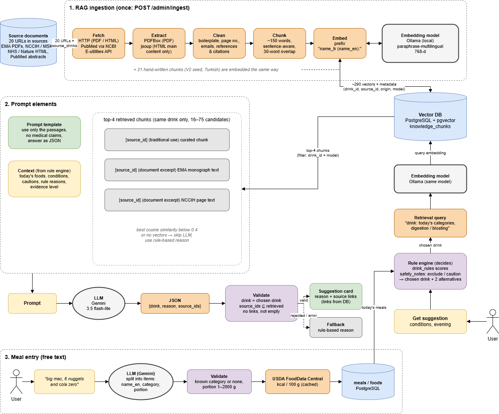
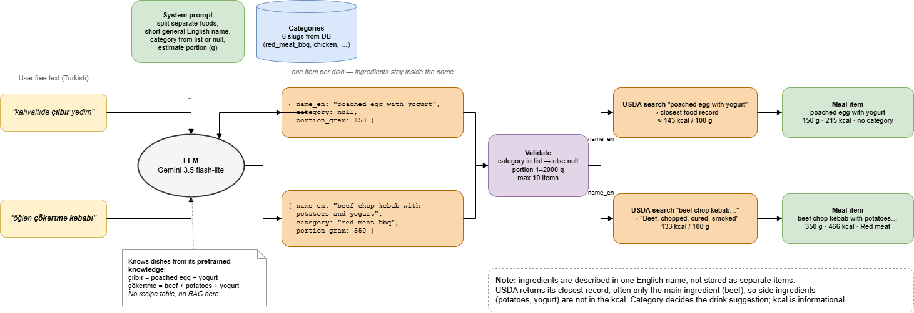

# Evening Drink

A small app that suggests an evening herbal tea, kefir or kombucha (such hazal things) based on what you ate during the day or typed in text area.

The goal is to try few products/tools together and having a free-text:

- **Java 21 + Spring Boot** – REST API and a web UI
- **Docker** (very simplified) – pgvector
- **LLM (Gemini)** – parses free-text user entries and writes the explanation for the suggestions
- **RAG** – an ingestion pipeline downloads the source documents (EMA monographs as PDF, NCCIH/NHS pages as HTML, PubMed abstracts via the NCBI E-utilities API), chunks them and embeds the chunks with Ollama into pgvector. For suggestion the most similar chunks are retrieved and the LLM writes only from them, citing source IDs that are checked against the retrieval result
- **External API** – USDA FoodData Central

Ollama, Gemini and USDA FoodData Central were chosen because they are free to use (Ollama runs locally, Gemini and USDA have free API tiers), not because they are the best fit for the task.

## Architecture



How free-text meal entries are parsed:



## Running
Requirements: Java 21, Docker, [Ollama](https://ollama.com/download)

1. Pull the embedding model:
   ```
   ollama pull paraphrase-multilingual
   ```
2. Copy `.env.example` to `.env` and add your keys:
   - `GEMINI_API_KEY` – https://aistudio.google.com/apikey
   - `USDA_API_KEY` – https://fdc.nal.usda.gov/api-key-signup (optional)
3. Start the database and the app:
   ```
   docker compose up -d
   ./mvnw spring-boot:run        (Windows: .\mvnw.cmd spring-boot:run)
   ```
4. On first run, ingest the source documents once (downloads, chunks and embeds them; takes a few minutes):
   ```
   curl -X POST http://localhost:8080/admin/ingest        (Windows PowerShell: curl.exe ...)
   ```
   Downloaded documents are not stored in the repository; only their chunks go into the local database.
5. Open http://localhost:8080

If the default Gemini model isn't available on your account, set `GEMINI_MODEL=...` in `.env`.
